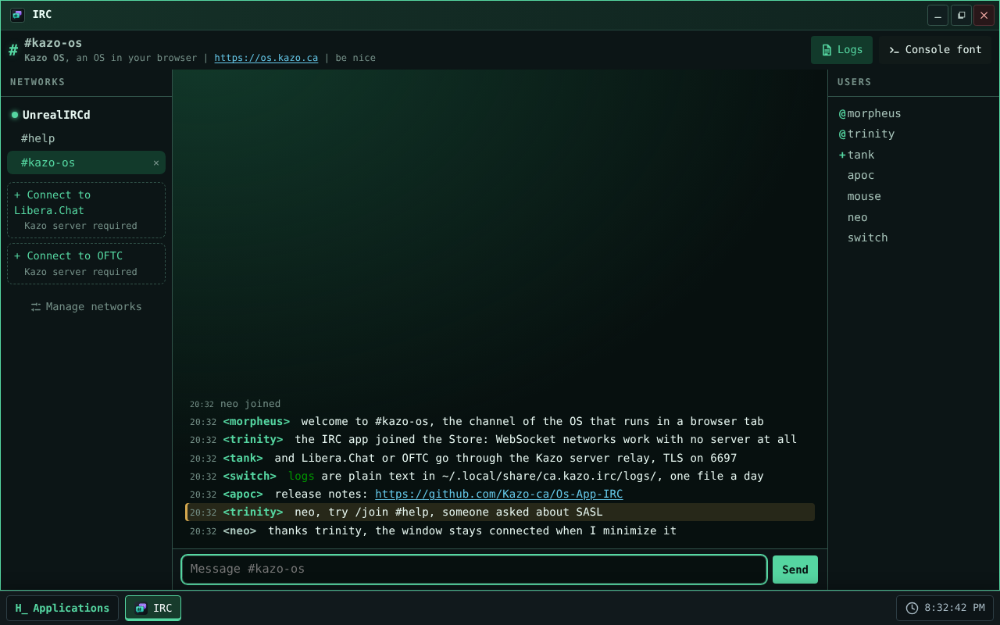
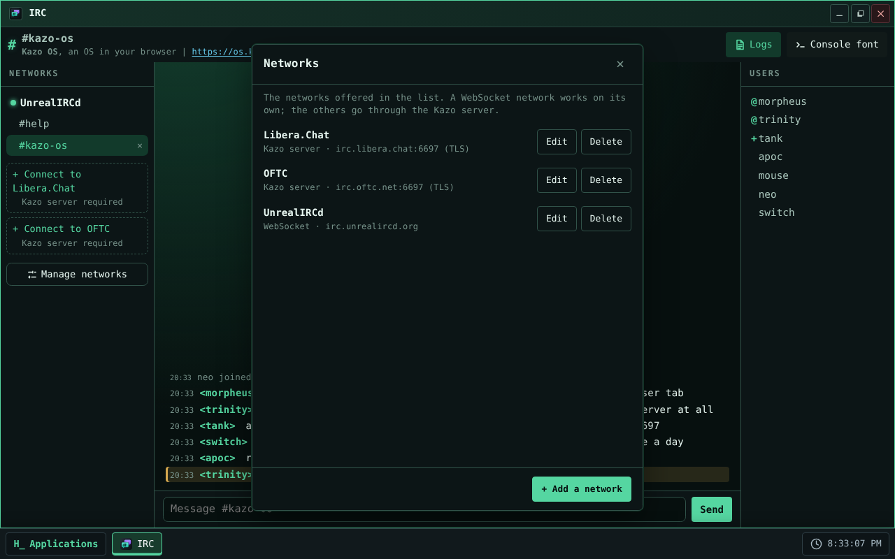
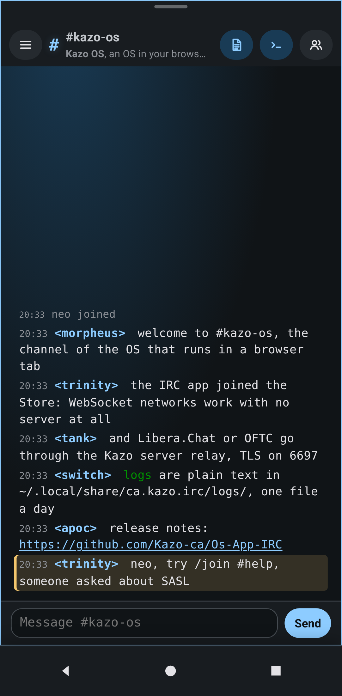

> [Version française](readme-fr.md)

<!-- Store listing: generated from store/ by .github/scripts/store-readme.mjs. Edit store/, then run it. -->


# IRC

A native Kazo OS chat client, written in C# and Blazor, for **real IRC networks**, on a computer and
on a phone. It follows the OS theme; a fixed-width font is offered for a "console" look.

## Connecting

- **Without any server, over WebSocket.** The proposed network is UnrealIRCd
  (`wss://irc.unrealircd.org/`). Any network that accepts IRC over WebSocket (IRCv3,
  `text.ircv3.net`) can be added with "Manage networks".
- **Through the Kazo server, for the other networks.** Libera.Chat and OFTC do not accept WebSocket:
  IRC goes through the relay of the optional Kazo OS server, over TCP, with TLS on port 6697 (6667
  in clear). These networks are marked "Kazo server required". The option is always offered and
  tried when you connect; with no Kazo server connected, IRC says so clearly ("No Kazo server
  connected").
- Your nickname is your Kazo OS user name; it can be changed per network. The SASL password of an
  account is kept in the OS keyring, never in a file.
- The networks and the channels they join automatically are in
  `~/.config/ca.kazo.irc/networks.json`.

## Administrator approval

IRC asks for access to the **real network** (`network.real.access`), a capability Kazo OS reserves to
the administrator. At the first launch, Kazo OS asks an administrator to approve it; the approval
window also lists the ports the app declares for the Kazo server's relay (`tcp/6697` and
`tcp/6667`).

## Chatting

- Three columns on a computer (networks and channels, messages, users); one column with side panels
  on a phone.
- Commands `/join /part /msg /me /nick /topic /whois /away /quit /query /raw`, input history (↑ and
  ↓) and nickname completion (Tab).
- Common IRCv3: CAP, SASL, server-time, message-tags, away-notify, multi-prefix, account-notify;
  automatic reconnection that rejoins the channels.
- A mention or a private message while the window does not have the focus: a Kazo OS notification
  with its sound, a count in the title ("(2) IRC") and badges in the channel list.
- IRC colors and bold are drawn; a web address in a message opens in the Kazo OS Browser.
- One window; it stays connected when minimized, and closing it quits the networks.

## Logs

Conversations are written per day, as text, in
`~/.local/share/ca.kazo.irc/logs/<network>/<channel>/YYYY-MM-DD.log`, where the other Kazo OS apps
can read them. The "Logs" button of the toolbar turns them off.

## Limits of the first version

- No file transfer (DCC): it would need to accept incoming connections.
- `irc://` links do not open in IRC yet (Kazo OS cannot associate an address scheme with an app yet).
- Needs Kazo OS 3.2.0 or later.

## License

IRC is free software under the MIT license. It bundles no third-party work: the code, the interface
and the icon are this repository's own.

## Screenshots

<p>
  
  
  
</p>

<!-- /Store listing -->

## Try it

<!-- "Open in Kazo OS" link: https://os.kazo.ca/?autolaunch=ca.kazo.irc goes here once Kazo OS supports it. -->

Open [Kazo OS](https://os.kazo.ca/) and install IRC from the **Kazo OS Store** (category Communication), or in the Kazo OS Terminal, as an administrator: `sudo kazopkg install Kazo-ca/Os-App-IRC`.

## About Kazo OS

[Kazo OS](https://github.com/Kazo-ca/Os) is a simulated operating system that runs in the browser, written in C# with Blazor WebAssembly. It gives a complete environment to build and run applications: desktop and windows, a persistent file system, processes, a POSIX shell, a simulated network, the Kazo OS Store, and a public SDK (NuGet packages) to make apps such as this one. Try it at <https://os.kazo.ca/> (PWA, works offline).

## Development

- Plan: [English](doc/en/plan.md) · [Français](doc/fr/plan.md)
- Architecture of the code: [English](doc/en/architecture.md) · [Français](doc/fr/architecture.md)
- License: MIT ([LICENSE](LICENSE)); third-party works: [THIRD-PARTY-NOTICES.md](THIRD-PARTY-NOTICES.md).

### Build and run

```bash
git clone --recurse-submodules https://github.com/Kazo-ca/Os-App-IRC.git
cd Os-App-IRC
dotnet run --project src/Kazo.Irc.Os      # Kazo OS with the IRC app, on http://localhost:5310
```

The `external/KazoOs` submodule is Kazo OS on its release tag (3.2.0): it gives the version of the
Kazo OS packages. `Debug` builds the OS from the submodule's sources, `Release` takes the packages
from nuget.org (what CI and the Kazo OS Store build).

### Tests

```bash
dotnet build Kazo.Irc.slnx -c Release -p:IrcDemoNetwork=true   # the E2E tests use the demonstration network
dotnet test Kazo.Irc.slnx -c Release --no-build
npm ci && npx playwright install chromium
npm run test:e2e                            # the app in the Kazo OS host, desktop and phone
```

The Store build has no demonstration network, and puts the protocol library inside `Kazo.Irc.dll`
(Kazo OS 3.2.0 packs one assembly per app, [Os#419](https://github.com/Kazo-ca/Os/issues/419)):

```bash
dotnet build src/Kazo.Irc -c Release -t:KazoOsPack       # the package, in src/Kazo.Irc/bin/kazoos-packages
npm run test:installed -- <Kazo OS wwwroot> src/Kazo.Irc/bin/kazoos-packages   # installed by kazopkg, in a published Kazo OS
dotnet build src/Kazo.Irc.Os -c Release && npm run store:screenshots          # store/screenshots/
```

See "Kazo OS Store listing and installed app" in the [architecture](doc/en/architecture.md).
