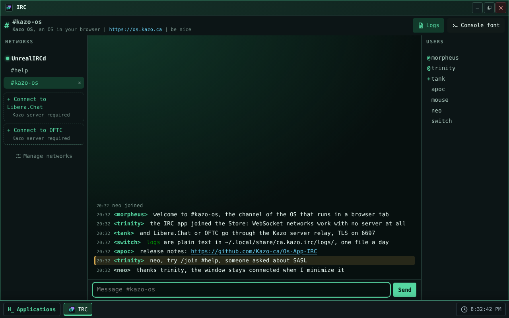
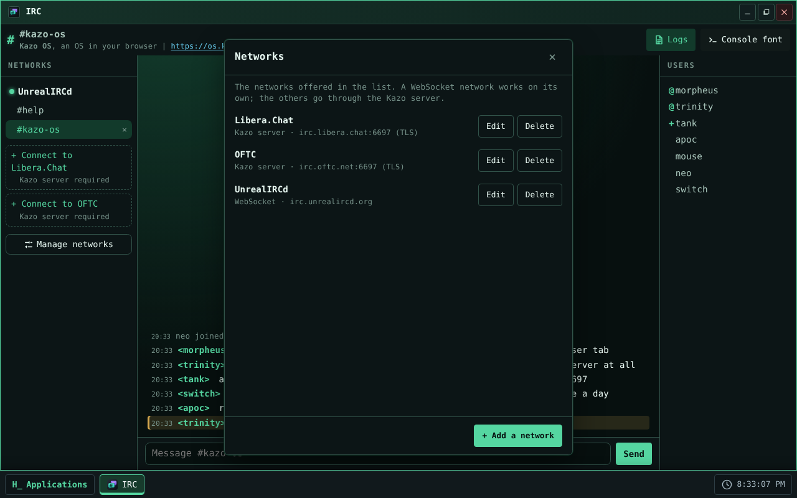
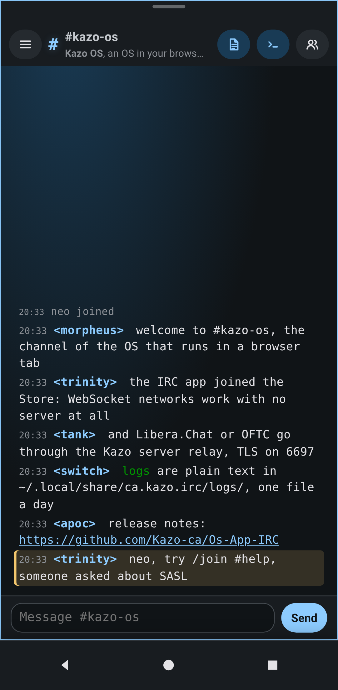

> [English version](README.md)

<!-- Fiche du Store : le même texte que store/description.fr.md et les mêmes captures que le Kazo OS Store (store/screenshots/). Les changer ensemble. -->


# IRC

Un client de discussion IRC natif de Kazo OS, écrit en C# et Blazor, pour les **vrais réseaux IRC**,
sur ordinateur et sur téléphone. Il suit le thème de l'OS ; une police à chasse fixe est proposée
pour l'aspect « console ».

## Se connecter

- **Sans aucun serveur, par WebSocket.** Le réseau proposé est UnrealIRCd
  (`wss://irc.unrealircd.org/`). Tout réseau qui accepte IRC par WebSocket (IRCv3,
  `text.ircv3.net`) peut être ajouté par « Gérer les réseaux ».
- **Par le serveur Kazo, pour les autres réseaux.** Libera.Chat et OFTC n'acceptent pas WebSocket :
  IRC passe par le relais du serveur optionnel de Kazo OS, en TCP, avec TLS sur le port 6697 (6667
  en clair). Ces réseaux sont marqués « Serveur Kazo requis ». L'option est toujours proposée et
  essayée quand vous vous connectez ; sans serveur Kazo connecté, IRC le dit clairement (« Aucun
  serveur Kazo connecté »).
- Votre pseudo est votre nom d'utilisateur de Kazo OS ; il se change par réseau. Le mot de passe
  SASL d'un compte est gardé dans le trousseau de l'OS, jamais dans un fichier.
- Les réseaux et leurs salons rejoints automatiquement sont dans
  `~/.config/ca.kazo.irc/networks.json`.

## Approbation de l'administrateur

IRC demande l'accès au **vrai réseau** (`network.real.access`), une capacité que Kazo OS réserve à
l'administrateur. Au premier lancement, Kazo OS demande à un administrateur de l'approuver ; la
fenêtre d'approbation liste aussi les ports que l'app déclare pour le relais du serveur Kazo
(`tcp/6697` et `tcp/6667`).

## Discuter

- Trois colonnes sur ordinateur (réseaux et salons, messages, utilisateurs) ; une colonne avec des
  panneaux sur téléphone.
- Commandes `/join /part /msg /me /nick /topic /whois /away /quit /query /raw`, historique de la
  saisie (↑ et ↓) et complétion des pseudos (Tab).
- IRCv3 courant : CAP, SASL, server-time, message-tags, away-notify, multi-prefix, account-notify ;
  reconnexion automatique avec retour dans les salons.
- Une mention ou un message privé quand la fenêtre n'a pas le focus : notification de Kazo OS avec
  son, compteur dans le titre (« (2) IRC ») et pastilles dans la liste des salons.
- Les couleurs et le gras IRC sont dessinés ; une adresse web d'un message s'ouvre dans le
  Navigateur de Kazo OS.
- Une seule fenêtre ; elle reste connectée quand elle est réduite, et la fermer quitte les réseaux.

## Journaux

Les discussions sont écrites par jour, en texte, dans
`~/.local/share/ca.kazo.irc/logs/<réseau>/<salon>/AAAA-MM-JJ.log`, où les autres apps de Kazo OS
peuvent les lire. Le bouton « Journaux » de la barre d'outils les coupe.

## Limites de la première version

- Pas de transfert de fichiers (DCC) : il faudrait accepter des connexions entrantes.
- Les liens `irc://` ne s'ouvrent pas encore dans IRC (Kazo OS ne sait pas encore associer un schéma
  d'adresse à une app).
- Demande Kazo OS 3.2.0 ou plus récent.

## Licence

IRC est un logiciel libre sous licence MIT. Il n'embarque aucune œuvre tierce : le code, l'interface
et l'icône sont ceux du dépôt.

## Captures d'écran

<p>
  
  
  
</p>

<!-- /Fiche du Store -->

## Essayer

<!-- Lien « Ouvrir dans Kazo OS » : https://os.kazo.ca/?autolaunch=ca.kazo.irc va ici quand Kazo OS le prendra en charge. -->

Ouvrez [Kazo OS](https://os.kazo.ca/) et installez IRC depuis le **Kazo OS Store** (catégorie Communication), ou dans le Terminal de Kazo OS, en administrateur : `sudo kazopkg install Kazo-ca/Os-App-IRC`.

## À propos de Kazo OS

[Kazo OS](https://github.com/Kazo-ca/Os) est un système d'exploitation simulé qui tourne dans le navigateur, écrit en C# avec Blazor WebAssembly. Il offre un environnement complet pour développer et exécuter des applications : bureau et fenêtres, système de fichiers persistant, processus, shell POSIX, réseau simulé, le Kazo OS Store, et un SDK public (paquets NuGet) pour créer des apps comme celle-ci. Essayez-le sur <https://os.kazo.ca/> (PWA, fonctionne hors ligne).

## Développement

- Plan : [Français](doc/fr/plan.md) · [English](doc/en/plan.md)
- Architecture du code : [Français](doc/fr/architecture.md) · [English](doc/en/architecture.md)
- Licence : MIT ([LICENSE](LICENSE)) ; œuvres tierces : [THIRD-PARTY-NOTICES.md](THIRD-PARTY-NOTICES.md).

### Compiler et lancer

```bash
git clone --recurse-submodules https://github.com/Kazo-ca/Os-App-IRC.git
cd Os-App-IRC
dotnet run --project src/Kazo.Irc.Os      # Kazo OS avec l'app IRC, sur http://localhost:5310
```

Le sous-module `external/KazoOs` est Kazo OS sur son tag de release (3.2.0) : il donne la version
des paquets Kazo OS. `Debug` compile l'OS depuis les sources du sous-module, `Release` prend les
paquets de nuget.org (ce que compilent la CI et le Kazo OS Store).

### Tests

```bash
dotnet build Kazo.Irc.slnx -c Release -p:IrcDemoNetwork=true   # les tests E2E utilisent le réseau de démonstration
dotnet test Kazo.Irc.slnx -c Release --no-build
npm ci && npx playwright install chromium
npm run test:e2e                            # l'app dans l'hôte Kazo OS, ordinateur et téléphone
```

Le build du Store n'a pas le réseau de démonstration, et met la bibliothèque du protocole dans
`Kazo.Irc.dll` (Kazo OS 3.2.0 met une assembly par app dans un paquet,
[Os#419](https://github.com/Kazo-ca/Os/issues/419)) :

```bash
dotnet build src/Kazo.Irc -c Release -t:KazoOsPack       # le paquet, dans src/Kazo.Irc/bin/kazoos-packages
npm run test:installed -- <wwwroot de Kazo OS> src/Kazo.Irc/bin/kazoos-packages   # installé par kazopkg, dans un Kazo OS publié
dotnet build src/Kazo.Irc.Os -c Release && npm run store:screenshots             # store/screenshots/
```

Voir « Fiche du Kazo OS Store et app installée » dans l'[architecture](doc/fr/architecture.md).
